<div align="center">

# Ту-95 Bear

**Fly six of the heaviest aircraft ever built through eight hand-crafted sorties, in your browser.**

A 2D flight game written in one dependency-free HTML file. Take off, land, thread valley gates, bomb a range, refuel in mid-air, drop supplies and bail out of a burning bomber in a night storm.

[](https://harrisbasra.github.io/tu95-bear/)
[](https://harrisbasra.github.io/tu95-bear/3d/)

[](https://github.com/harrisbasra/tu95-bear/actions/workflows/ci.yml)
[](LICENSE)
[](CONTRIBUTING.md)


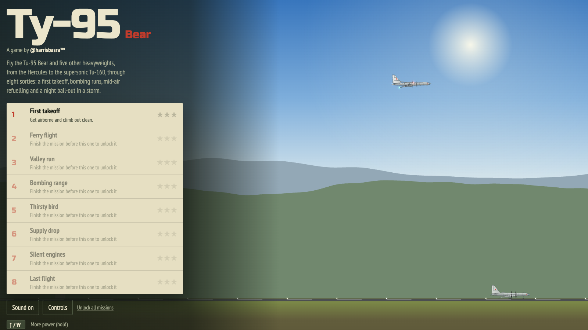

</div>

---

## Features

- **Six aircraft, each with its own handling.** Tu-95MS Bear, C-130J Hercules, C-17A Globemaster III, B-52H Stratofortress, B-1B Lancer and Tu-160 Blackjack. Each has its own mass, wing area, thrust, drag polar and gear geometry. The B-52 lifts off almost level on its bicycle gear, and the swing-wing bombers are fast but unforgiving.
- **Eight missions** that each teach one skill, with a written briefing and a three-star rating.
- **A flight model you can feel.** Lift, drag, stalls, flap stages, gear drag, ground effect, wind, fuel burn, tail strikes and hard landings.
- **Live guidance.** Predicted impact arcs for bombs, crates and your own parachute, and an approach-light guide for landings.
- **Six skies.** Morning, midday, overcast, dusk, sunset and a stormy night, plus procedural terrain, clouds, rain and fire.
- **Synthesised sound.** Engine drone, wind and effects come from the Web Audio API. There are no audio files.
- **Plays on phones and tablets** with on-screen controls, safe-area support and a rotate hint.
- **Respects your settings.** Light and dark colour schemes, reduced motion and keyboard focus are all handled.
- **Saves progress** (stars, unlocked missions, last aircraft) in your browser.

## Screenshots

| | |
|:---:|:---:|
| 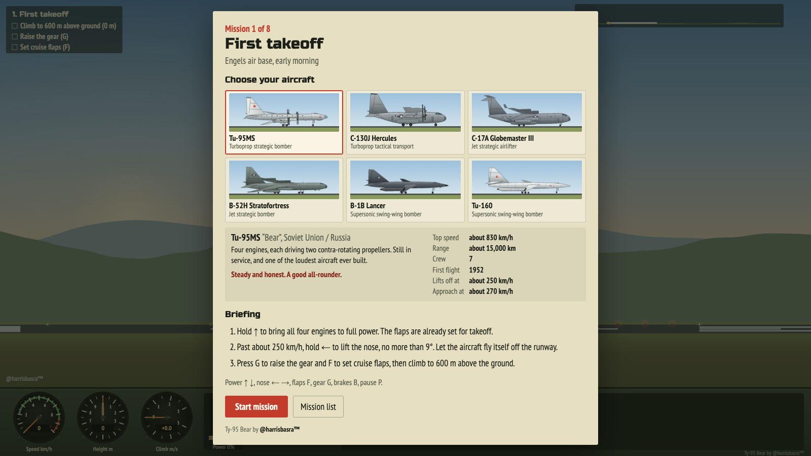 | 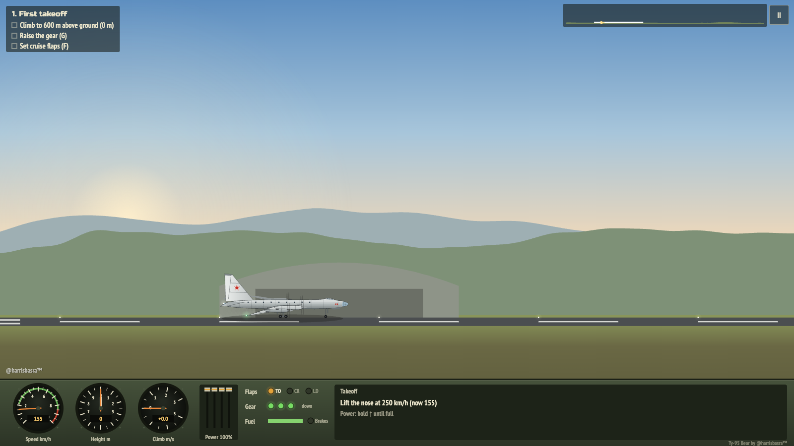 |
| **Pick your aircraft** in every briefing | **Takeoff roll** at Engels air base |
| 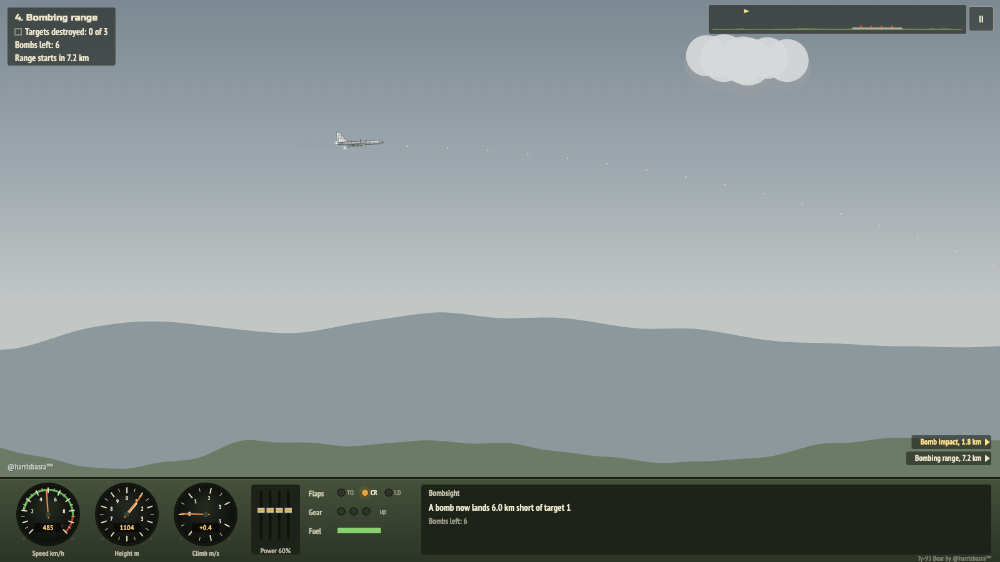 | 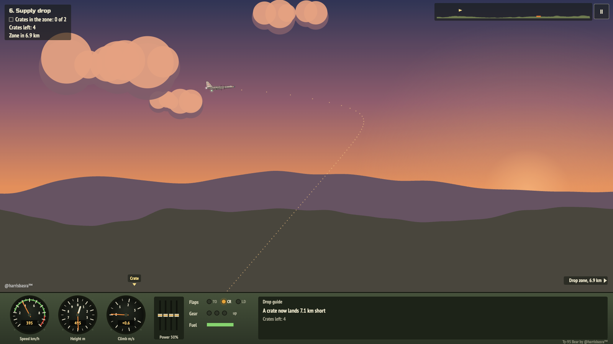 |
| **Bombing range** with the predicted arc | **Supply drop** into a crosswind at dusk |

<p align="center">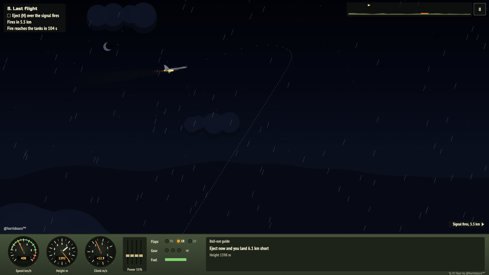<br><b>Last flight:</b> bail out over the signal fires before the tanks go</p>

## 3D: Lahore and the world (beta)

A full 3D version, with **Allama Iqbal International Airport (OPLA), Lahore** as home base and seven more airports a world map away. Fly it at [harrisbasra.github.io/tu95-bear/3d](https://harrisbasra.github.io/tu95-bear/3d/), or pick **3D** under **Version** on either menu. The game remembers your choice, and `?2d` always opens the 2D game.

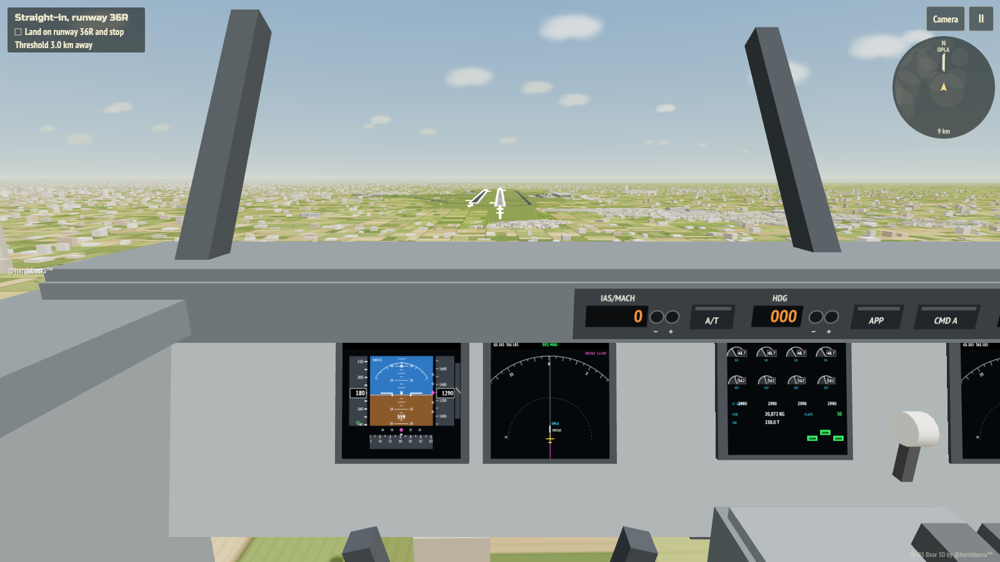

- **Thirteen aircraft with real numbers.**
  - **Bombers and transports:** Tu-95MS, C-130J, C-17A, B-52H, B-1B and Tu-160.
  - **Airliners:** Boeing 737-800, 747-400, 777-300ER and 787-9, and Airbus A320, A350-900 and A380-800.
  - **Published data:** each one uses its published empty, landing and takeoff weights, fuel, wing area, span, thrust, speed limits and flap detents. Lift is calibrated from the real approach speed, so a heavy 777 needs the runway and a light A320 floats.
- **Real airliner shapes.**
  - **Fuselages:** proportions from published three-views, the 747's upper deck and the A380's double deck.
  - **Wings:** cranked wings with flap track fairings, working flaps and spoilers, plus each type's own wingtip: blended winglets, sharklets, raked tips or a wingtip fence.
  - **Engines and gear:** high-bypass engines on pylons and the real bogies (the 777's six-wheel trucks, the 747's and A380's body gear).
  - **Details:** windows, doors, an APU exhaust, strobes and beacons.
  - **Paint:** every airliner wears the game's own invented house colours. There are no airline liveries or manufacturer logos.
- **3D cockpits** (<kbd>C</kbd> cycles chase, cockpit and tower).
  - **Airliners:** a glass cockpit built as real geometry.
    - Live displays: PFD (attitude, speed and altitude tapes, vertical speed, heading, flight director, ILS deviation and flight modes), ND (map with runways and the route to the runway) and engine and systems pages.
    - Controls: an MCP or FCU you can click, an overhead panel, a moving yoke or Airbus sidestick, and thrust, flap, speedbrake and gear levers.
  - **Bombers and transports:** a classic panel of round gauges. Soviet types get the turquoise of the real thing.
  - **Free look and units:** drag to look around. The instruments read knots and feet, like the real aircraft.
- **Autopilot and autothrottle** on every aircraft.
  - **Modes:** heading, altitude and speed hold.
  - **Approach mode:** captures the localiser and glide path, then flares, retards, rolls out on the centreline and brakes with reverse thrust. It's a full autoland.
- **Eight airports, one region at a time.**
  - **Pakistan:** Lahore (OPLA), Islamabad (OPIS) and Karachi (OPKC).
  - **Elsewhere:** Dubai (OMDB), London Heathrow (EGLL), New York JFK (KJFK), Istanbul (LTFM) and Jeddah (OEJN).
  - **Runways:** every runway uses published threshold coordinates, lengths, widths and elevations, including displaced thresholds (JFK and Dubai have big ones). Each has markings, lighting, PAPIs and approach lights.
  - **Layouts:** taxiways, aprons, stands, jet bridges and terminals come from OpenStreetMap for all eight airports.
  - **Surroundings:** each airport has its city, coast, rivers and hills, and simplified, labelled landmarks:
    - **Pakistan:** Faisal Mosque, Mazar-e-Quaid.
    - **Gulf:** Burj Khalifa, Burj Al Arab, King Fahd's Fountain.
    - **London:** Windsor Castle, the Shard.
    - **New York:** the Empire State Building, One World Trade Center, the Statue of Liberty.
    - **Istanbul:** Hagia Sophia, the Blue Mosque.
- **Fly between them.** Pick a departure and a destination on the world map, then fly the whole trip.
  - **Planning:** the planner chooses the runways, a cruise level and the fuel for your aircraft and load, and warns you when a route is beyond its range.
  - **Navigation:** NAV follows the great-circle route to the final approach fix; VNAV holds the cruise level, then descends on a 3° path.
  - **Long cruises:** speed up time (up to ×32) or skip straight to the descent. Skipping burns the fuel the skipped cruise would have used.
- **Career mode.** Start with a used 737-800 at your home base and fly passenger and cargo jobs between the eight airports.
  - **What you're paid:** distance and load, plus bonuses or penalties for arriving on time and for the landing (touchdown rate and centreline).
  - **Penalties:** fines for overspeed, part payment and compensation for diversions, and a hull loss if you crash.
  - **Costs from the flight you actually flew:** the fuel the flight model burned at that airport's price, landing fees by aircraft weight, crew hours and maintenance.
  - **Fleet:** hard landings add wear, worn aircraft lose a little thrust, and below 25% they're grounded until a maintenance check. Lease, buy new or used, and sell.
  - **Bank:** a bank account with a statement, loans with interest and monthly repayments, and monthly summaries. You rise through the ranks as your hours build.
  - **Virtual credits only.** Credits have no real value, and nothing in the game takes real money. The whole economy is tunable from one `ECON` object in `3d/src/f_career.js`. It is balanced for a game, not real airline finances: aircraft cost about a tenth of their real market value.
- **Allama Iqbal International, mapped.**
  - **From OpenStreetMap:** taxiways (B to Z), aprons, stands, jet bridges and the footprints of the 2,500 buildings around the field.
  - **The main terminal:** on the east side, with its long arched facade (simplified).
  - **Runways:** both use published threshold coordinates: 18L/36R (3,360 m, concrete) and 18R/36L (2,743 m, asphalt), 46 m wide at 217 m elevation. They have full markings, edge and approach lighting, a sequenced flasher on the ILS runways and working PAPIs.
- **Lahore around it.** A simplified city laid out by neighbourhood, with Minar-e-Pakistan, Badshahi Mosque and Lahore Fort, the Ravi, Punjab farmland and haze.
- **Real 3D flight.** The flight model includes:
  - an ISA atmosphere, with thrust lapse for turbofans, low-bypass engines and turboprops
  - fuel burn and a weight that falls as fuel burns
  - banking, sideslip, ground effect and crosswind
  - ground spoilers, reverse thrust, and nose-wheel and rudder steering
- **Built to be learnable.** All three assists are on by default:
  - **Flight assist** levels the wings, coordinates turns and stops tail strikes on rotation.
  - **Landing assist** softens the flare and kicks out the crosswind crab just before touchdown.
  - **Crash messages** say what went wrong and how to fix it.
- **Controllers.** Any gamepad works over USB or Bluetooth, with rumble for touchdowns, the runway and the stall stick-shaker. In Chrome and Edge on a computer, **Connect DualSense lights and triggers** adds more:
  - **Lightbar:** olive in flight, cyan on autopilot, amber for cautions, flashing red for warnings.
  - **Player LEDs:** show the flap position.
  - **Mute LED:** shows the autopilot.
  - **Adaptive triggers:** stiffen with airspeed.
- **Plays on phones.**
  - **Touch controls:** a stick, a power slider, and flap, gear, brake, speedbrake and autopilot buttons.
  - **Graphics setting:** low, medium or high scales shadows, the city and the cockpit display refresh rate.
- **Seven Lahore missions:** free flight, a departure, a straight-in approach, the Lahore circuit, an Old City flypast at dusk, a night arrival in a crosswind and an autoland. You can also fly any route on the world map, or a local flight at any airport.
- **Cloud saves for everything.** Sign in with Google and your pilot name, stars, career, fleet and bank statement follow you to any device. It works offline and syncs when you're back. Without signing in, everything saves in the browser. Setup: [docs/FIREBASE.md](docs/FIREBASE.md).
- **About cheating:** the cloud rules reject malformed saves and impossible numbers, such as absurd balances, sudden jumps or flight hours going backwards. A game that runs in your browser can still be modified by someone determined, so treat career balances as for fun, not as a leaderboard.

| | |
|:---:|:---:|
| 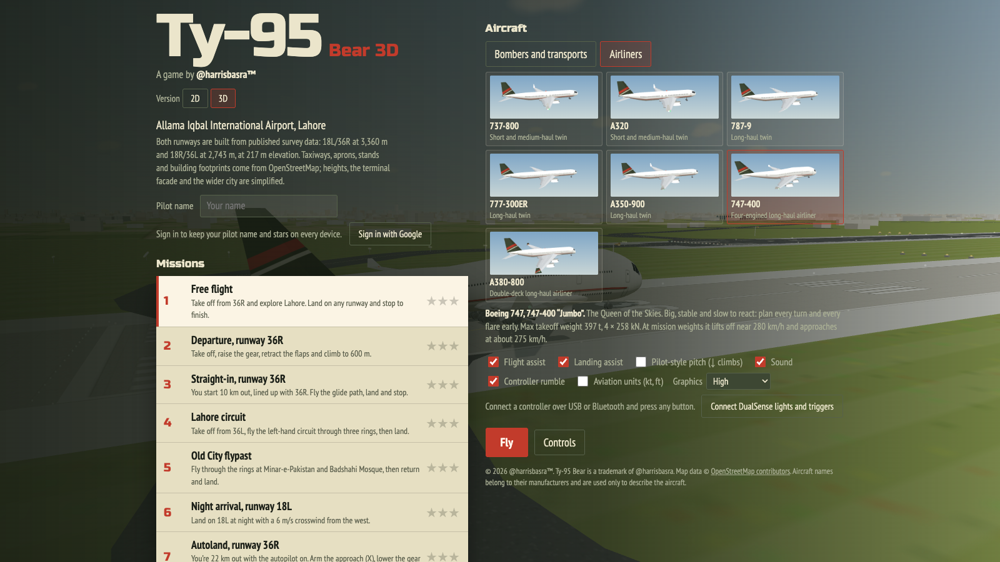 | 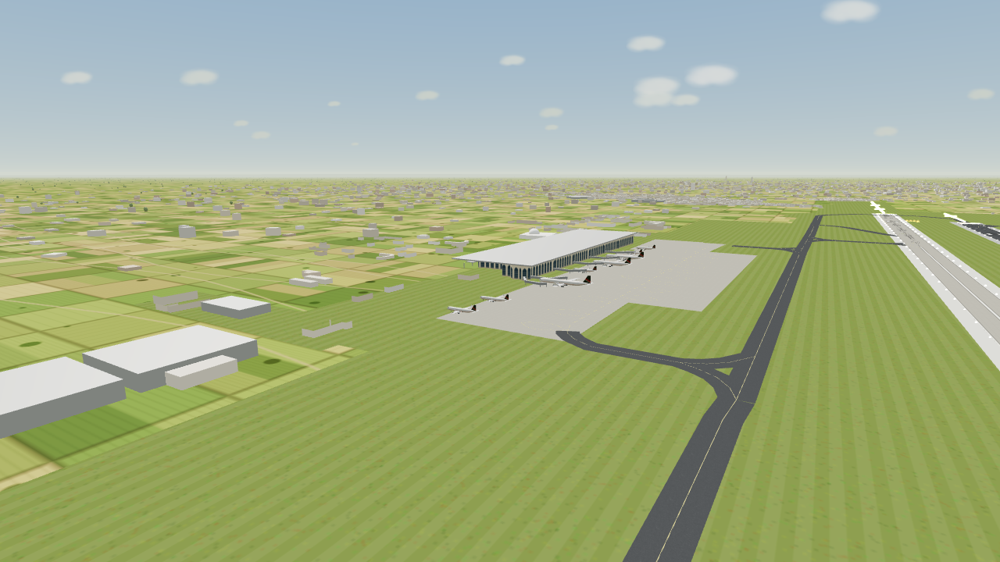 |
| **The hangar**: bombers and transports, and airliners | **The terminal** with airliners on the stands |
| 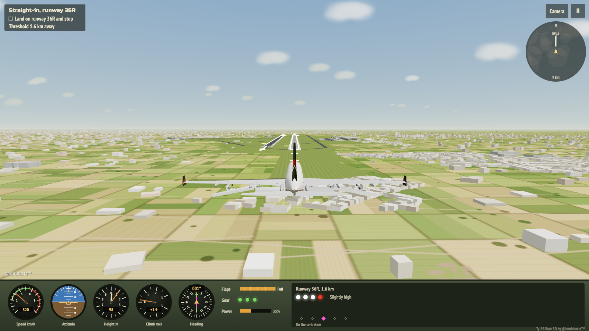 | 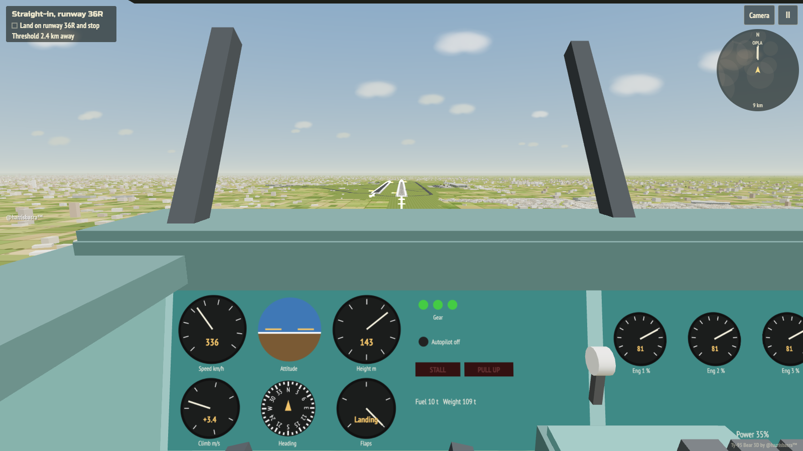 |
| **A380-800** on short final to 36R | **Classic cockpit** in the Tu-95 |
| 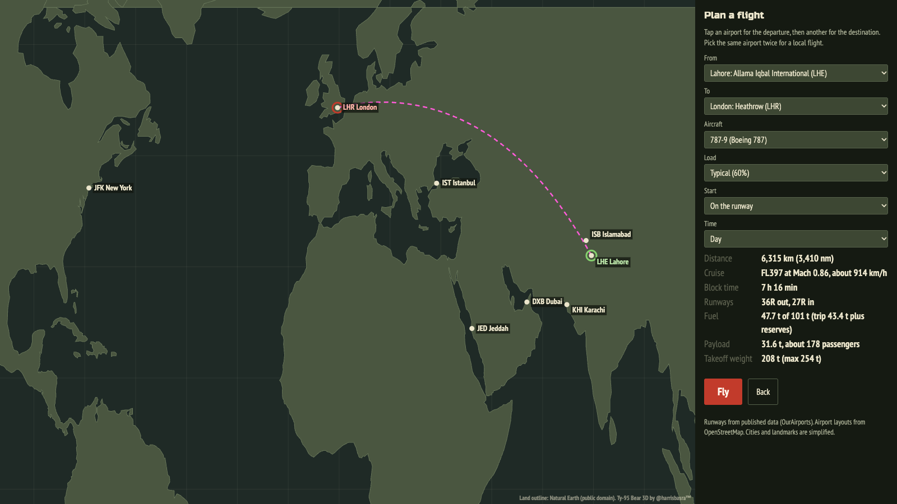 | 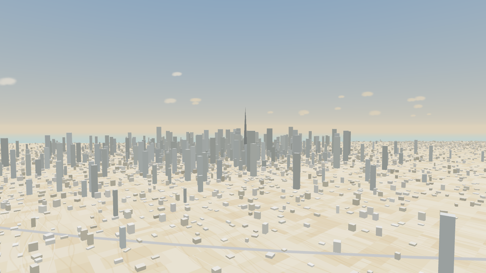 |
| **The world map**: plan a route, check the fuel and fly | **Dubai** with the Burj Khalifa (simplified) |
| 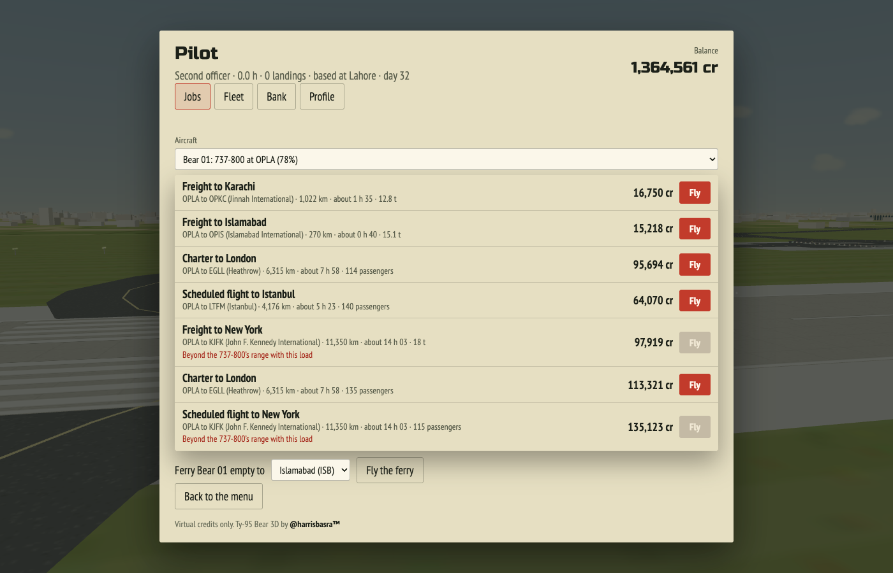 |  |
| **Career mode**: jobs from your aircraft's airport | **Glass cockpit** on final |
| 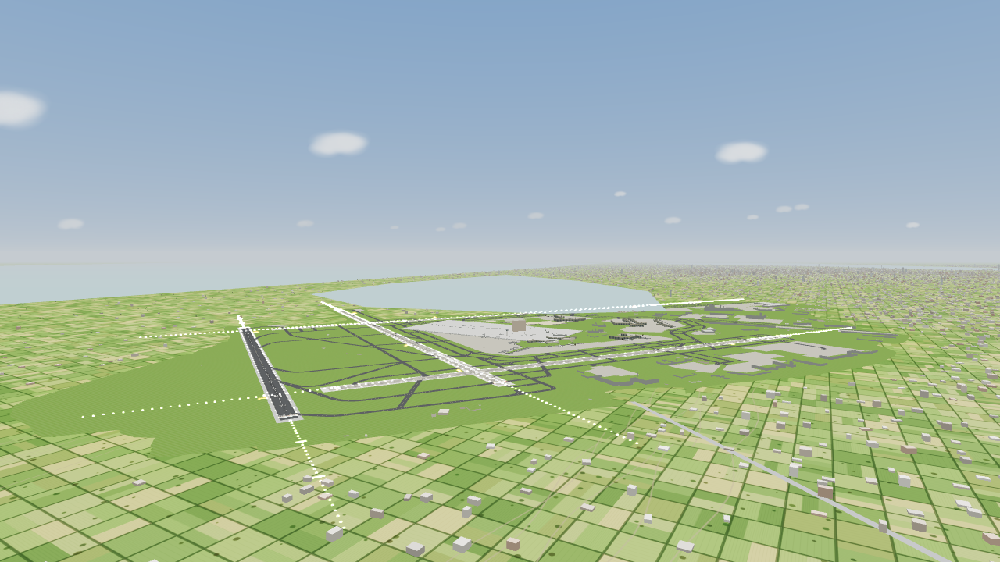 | 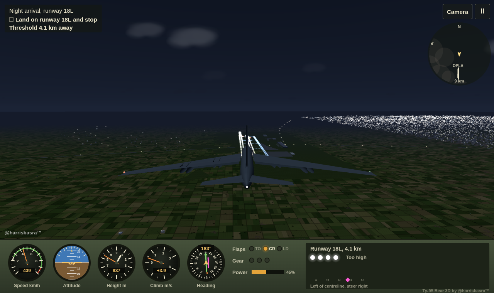 |
| **New York JFK** from OpenStreetMap, with Jamaica Bay | **Night arrival** on 18L at Lahore |

### 3D controls

| Key | Action |
|---|---|
| <kbd>↑</kbd> / <kbd>↓</kbd> | Nose up / nose down (swap these with **Pilot-style pitch**) |
| <kbd>←</kbd> / <kbd>→</kbd> | Roll left / right. On the ground: steer |
| <kbd>W</kbd> / <kbd>S</kbd> | Power up / down. <kbd>S</kbd> at idle on the ground: reverse thrust and brakes |
| <kbd>A</kbd> / <kbd>D</kbd> | Rudder |
| <kbd>F</kbd> / <kbd>V</kbd> | Flaps: extend / retract one notch (real detents, such as 1, 5, 15, 30 on a Boeing or 1, 1+F, 2, 3, Full on an Airbus) |
| <kbd>G</kbd> / <kbd>B</kbd> / <kbd>Q</kbd> | Gear / brakes / speedbrake |
| <kbd>Z</kbd> / <kbd>X</kbd> / <kbd>T</kbd> | Autopilot on or off / arm the approach / autothrottle |
| <kbd>N</kbd> / <kbd>J</kbd> | NAV (follow the route) / VNAV (cruise level and descent path) |
| <kbd>Y</kbd> / <kbd>K</kbd> | Speed up time (on the autopilot, above 900 m) / skip to the descent |
| <kbd>,</kbd> <kbd>.</kbd> · <kbd>−</kbd> <kbd>=</kbd> · <kbd>9</kbd> <kbd>0</kbd> | Autopilot heading, altitude and speed down / up |
| <kbd>C</kbd> | Camera: chase, cockpit, tower. Drag to look around; double-tap to recentre |
| <kbd>P</kbd> / <kbd>Esc</kbd>, <kbd>R</kbd> | Pause, restart |

On touch screens, a stick on the left flies the aircraft and a slider on the right sets the power. In the cockpit you can also tap the autopilot panel.

| Controller | Action |
|---|---|
| Left stick | Pitch and roll (steer on the ground) |
| L2 / R2 | Rudder |
| R1 / L1 | Power up / down (L1 at idle on the ground: reverse and brakes) |
| ✕ / □ / ○ / △ | Brakes / gear / speedbrake / camera |
| D-pad | ↑ ↓ flaps, ← autopilot, → arm the approach |
| Right stick, R3 | Look around, recentre |
| Options, Create | Pause, autothrottle |

### Where the numbers come from

- **Aircraft:**
  - Boeing *Airplane Characteristics for Airport Planning* and Airbus *Aircraft Characteristics: Airport and Maintenance Planning* documents.
  - EASA and FAA type-certificate data, and USAF fact sheets.
  - Standard references for the Tupolev types.
  - Reference speeds (Vref) and turboprop static thrust are estimates from published data. Planform details are approximate.
- **Airports:**
  - Runway ends, displaced thresholds, lengths and widths come from [OurAirports](https://ourairports.com/data/) (public domain), which is compiled from the national AIPs. ILS is assumed on every runway end at the big international airports; Lahore's is verified.
  - Coastlines, rivers, hills, city districts and visibility are simplified, and so are the landmark models.
  - The world map uses [Natural Earth](https://www.naturalearthdata.com/) 1:110m land (public domain).
- **Lahore:**
  - Runway thresholds come from OurAirports and the published AIP data.
  - Taxiways, aprons, stands, jet bridges and building footprints come from OpenStreetMap.
  - The terminal facade, building heights, the mosque dome and the control tower are simplified. The tower's placement isn't confirmed by any public source.
  - The city beyond the mapped area is procedural.

### 3D source

The 3D game uses [three.js](https://threejs.org/) r128 from cdnjs and otherwise follows the same no-build-step spirit: `3d/index.html` is committed and served as-is. It is generated from the readable sources in [`3d/src`](3d/src), which are joined in order inside one closure. After editing them, run `npm run build:3d`; `npm run check` fails if the two are out of sync. Each airport's map data and the world outline live in [`3d/data`](3d/data) and load only when needed.

| File | What's in it |
|---|---|
| `shell.html` | Markup and styles for the menus, overlays and touch controls |
| `b_core.js` | Utilities, the region geography (`setRegion`), units and the bomber and transport specs |
| `b_airports.js` | The airports: runways, elevations, districts, water, hills and landmarks. Add an airport here |
| `c_models.js` | Procedural bombers and transports built from fuselage stations, aerofoil slabs and engine pods |
| `c_airliners.js` | Airliner specs and the airliner builder: fuselage texture, cranked wings, wingtips, nacelles, bogies |
| `d_world.js` | Sky, terrain, runways and their lighting, the city, landmarks, river, trees and clouds |
| `d_airport.js` | Builds the taxiways, aprons, stands, jet bridges, buildings and parked airliners from the airport's map data |
| `e_physics.js` | The 3D flight model, ground handling and touchdown checks |
| `e_autopilot.js` | Autopilot and autothrottle, approach mode and autoland |
| `f_game.js` | Missions, rings, effects and cameras |
| `f_career.js` | Career mode: the `ECON` settings, jobs, settlement, fleet, bank, loans and months |
| `f_route.js` | Flights between airports: planning, great-circle navigation, region hand-offs, time acceleration and skipping ahead |
| `g_cockpit.js` | 3D cockpits, with live canvas displays and clickable autopilot panels |
| `g_pad.js` | Gamepad input, rumble, and the DualSense lightbar, LEDs and adaptive triggers over WebHID |
| `g_map.js` | The world map and flight planner |
| `g_career.js` | The career screens: jobs, fleet and market, bank and profile |
| `g_ui.js` | Instrument panel, radar, audio, input, cloud saves, menus and the main loop |

## Missions

| # | Mission | Where | Objective |
|:-:|---|---|---|
| 1 | **First takeoff** | Engels air base, early morning | Get airborne, raise the gear, set cruise flaps and climb to 600 m |
| 2 | **Ferry flight** | Engels to Saratov-South, midday | Fly 14 km east and land at the next airfield |
| 3 | **Valley run** | Volga uplands, early afternoon | Thread five marker gates at low level, then land |
| 4 | **Bombing range** | Kapustin Yar, overcast | Destroy three of four practice targets with six bombs |
| 5 | **Thirsty bird** | 3,000 m over the steppe | Catch the tanker and take on fuel before your tanks run dry |
| 6 | **Supply drop** | Outpost Kazbek, dusk | Parachute crates into a small zone in a 9 m/s headwind |
| 7 | **Silent engines** | Lower Volga, sunset | All engines have failed. Glide 15.5 km to the runway |
| 8 | **Last flight** | Night storm over the forest | Your aircraft is burning. Bail out over the rescue fires |

Missions unlock one at a time. There's an **Unlock all missions** link on the menu if you want to jump ahead.

## Controls

| Key | Action |
|---|---|
| <kbd>↑</kbd> / <kbd>W</kbd> | More power (hold) |
| <kbd>↓</kbd> / <kbd>S</kbd> | Less power. At zero power on the ground, this also brakes |
| <kbd>←</kbd> / <kbd>A</kbd> | Nose up |
| <kbd>→</kbd> / <kbd>D</kbd> | Nose down |
| <kbd>F</kbd> | Cycle flaps: takeoff, cruise, landing |
| <kbd>G</kbd> | Raise or lower the gear |
| <kbd>B</kbd> | Wheel brakes (hold) |
| <kbd>Space</kbd> | Mission action: drop a bomb or crate, or extend the refuelling probe |
| <kbd>H</kbd> | Eject |
| <kbd>P</kbd> / <kbd>Esc</kbd> | Pause |
| <kbd>R</kbd> | Restart the mission |
| <kbd>M</kbd> | Sound on or off |

On touch screens the same controls appear as on-screen buttons. Hold the phone sideways for the best view.

> **Tip:** For a smooth landing, fly the approach on landing flaps with the gear down. Aim for two white and two red approach lights, then cut the power just above the runway and ease the nose up. Touch down at 1.5 m/s or less for three stars.

## Running locally

There's no build step and nothing to install. The whole game is [`index.html`](index.html).

```bash
git clone https://github.com/harrisbasra/tu95-bear.git
cd tu95-bear
open index.html          # macOS. On Linux use xdg-open; on Windows use start
```

If you'd rather run it from a local web server:

```bash
npm start                # serves on http://localhost:8080
# or
python3 -m http.server 8080
```

Before opening a pull request, check that the script still parses:

```bash
npm run check
```

## How it works

Everything (HTML, CSS and about 1,500 lines of JavaScript) lives in one file and draws on a single `<canvas>`. The script is split into labelled sections:

| Section | What's in it |
|---|---|
| `missions` | The `MISSIONS` array: briefing text, terrain seed, airfields, targets, zones and start state |
| `specs` | One entry per aircraft: real-world facts, plus mass, wing area, thrust, drag and lift coefficients, and gear and hull points |
| `physics` | Integration of forces, ground contact, touchdown scoring and crash checks |
| `aircraft drawing kit` and per-aircraft sections | Each aircraft is drawn from canvas paths, so there are no sprites |
| `render`, `HUD` | Sky, terrain, effects, instruments, the map strip and the guidance panel |
| `audio` | The Web Audio engine and effect synthesis |
| `input`, `UI`, `loop` | Keyboard and touch input, menus and screens, and the `requestAnimationFrame` loop |

Read [CONTRIBUTING.md](CONTRIBUTING.md) for a walkthrough of adding a mission or an aircraft.

## Contributing

Contributions are welcome: bug fixes, new missions, new aircraft, flight-model tuning, accessibility, translations and more.

1. Read [CONTRIBUTING.md](CONTRIBUTING.md).
2. Find an issue, or open one to discuss your idea.
3. Fork, branch, make your change and open a pull request.

Everyone taking part is expected to follow the [Code of Conduct](CODE_OF_CONDUCT.md).

## Deployment

Every push to `main` deploys both games to **GitHub Pages** through [`.github/workflows/pages.yml`](.github/workflows/pages.yml): the 2D game at the site root and the 3D game at `/3d/`. Optional cloud saves for the 3D game use Firebase; see [docs/FIREBASE.md](docs/FIREBASE.md). The repo also includes a [`vercel.json`](vercel.json), so it can be deployed to Vercel as a static site without any extra setup.

## License

The code is released under the [MIT License](LICENSE). © 2026 Harris Khalid ([@harrisbasra](https://github.com/harrisbasra)).

"Ту-95 Bear" and the @harrisbasra™ name and branding identify the original game and are not covered by the code license. If you publish a fork, please give it your own name and keep the original credit. Aircraft names, including Boeing 737, 747, 777 and 787 and Airbus A320, A350 and A380, belong to their respective manufacturers and operators. They are used here only to describe the aircraft, and this project is not affiliated with or endorsed by any of them. Airport and landmark layouts are simplified.

The airport map data in `3d/data/` (every file except `world.js`) is derived from [OpenStreetMap](https://www.openstreetmap.org/copyright), © OpenStreetMap contributors, and is available under the [Open Database Licence](https://opendatacommons.org/licenses/odbl/).

<div align="center">

Made with ☕ and a lot of turboprop noise by **[@harrisbasra](https://github.com/harrisbasra)**

If you enjoy the game, give it a ⭐. It helps other people find it.

</div>
