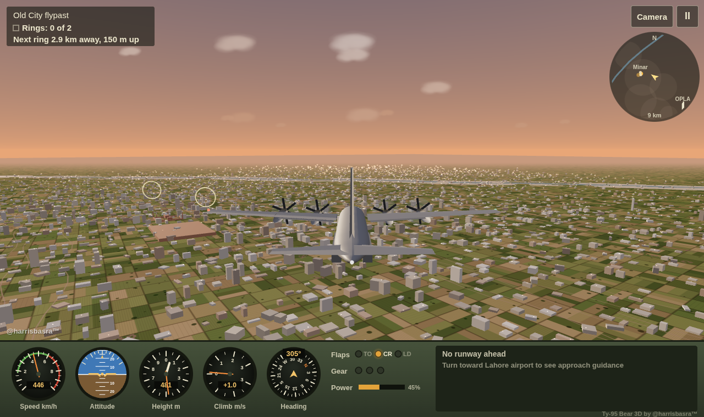
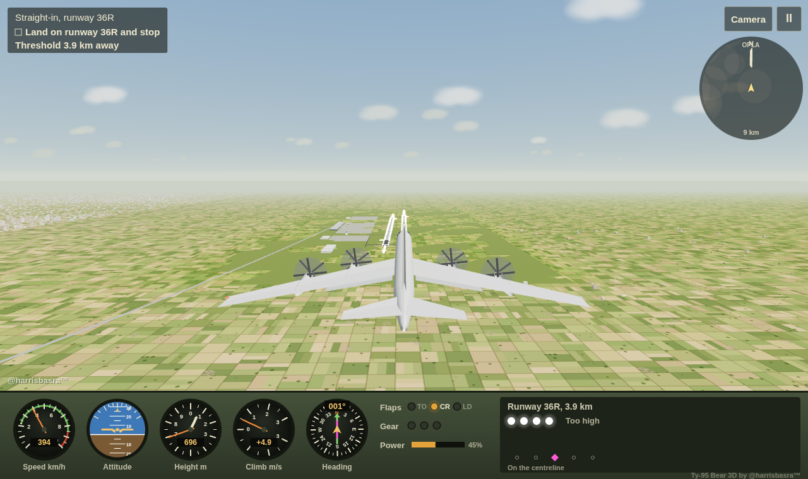
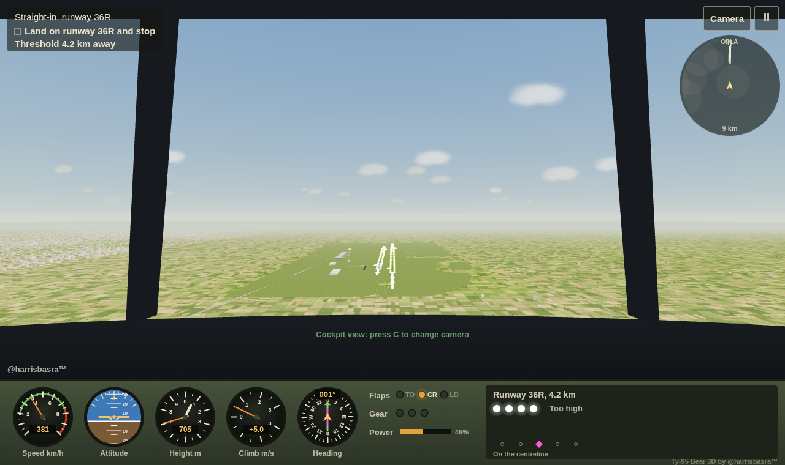
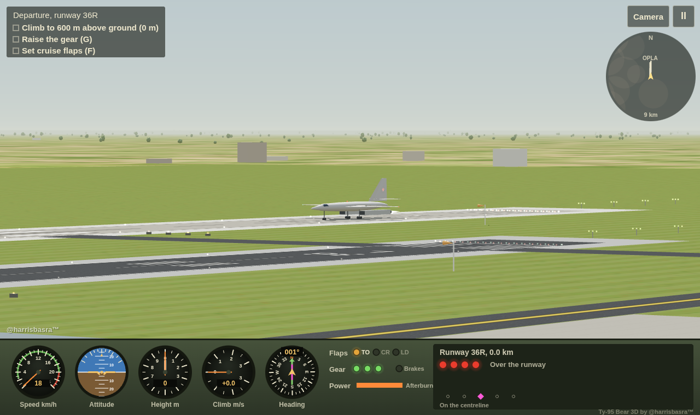

<div align="center">

# Ту-95 Bear

**Fly six of the heaviest aircraft ever built through eight hand-crafted sorties, in your browser.**

A 2D flight game written in one dependency-free HTML file. Take off, land, thread valley gates, bomb a range, refuel in mid-air, drop supplies and bail out of a burning bomber in a night storm.

[](https://harrisbasra.github.io/tu95-bear/)
[](https://harrisbasra.github.io/tu95-bear/3d/)

[](https://github.com/harrisbasra/tu95-bear/actions/workflows/ci.yml)
[](LICENSE)
[](CONTRIBUTING.md)


</div>

---

## Features

- **Six aircraft, each with its own handling.** Tu-95MS Bear, C-130J Hercules, C-17A Globemaster III, B-52H Stratofortress, B-1B Lancer and Tu-160 Blackjack. Each has its own mass, wing area, thrust, drag polar and gear geometry. The B-52 lifts off almost level on its bicycle gear, and the swing-wing bombers are fast but unforgiving.
- **Eight missions** that each teach one skill, with a written briefing and a three-star rating.
- **A flight model you can feel.** Lift, drag, stalls, flap stages, gear drag, ground effect, wind, fuel burn, tail strikes and hard landings.
- **Live guidance.** Predicted impact arcs for bombs, crates and your own parachute, and an approach-light guide for landings.
- **Six skies.** Morning, midday, overcast, dusk, sunset and a stormy night, plus procedural terrain, clouds, rain and fire.
- **Synthesised sound.** Engine drone, wind and effects come from the Web Audio API. There are no audio files.
- **Plays on phones and tablets** with on-screen controls, safe-area support and a rotate hint.
- **Respects your settings.** Light and dark colour schemes, reduced motion and keyboard focus are all handled.
- **Saves progress** (stars, unlocked missions, last aircraft) in your browser.

## Screenshots

| | |
|:---:|:---:|
|  |  |
| **Pick your aircraft** in every briefing | **Takeoff roll** at Engels air base |
|  |  |
| **Bombing range** with the predicted arc | **Supply drop** into a crosswind at dusk |

<p align="center"><br><b>Last flight:</b> bail out over the signal fires before the tanks go</p>

## 3D: Lahore (beta)

A full 3D version set at **Allama Iqbal International Airport (OPLA), Lahore**. Fly it at [harrisbasra.github.io/tu95-bear/3d](https://harrisbasra.github.io/tu95-bear/3d/), or from the **Fly in 3D** button on the 2D menu.



- **The real airport.** Both runways come from published survey data: 18L/36R (3,360 m, concrete) and 18R/36L (2,743 m, asphalt), 46 m wide at 217 m elevation, with their real thresholds, headings and spacing. They have full markings, edge lights, approach lighting with a sequenced flasher on the ILS runways, and working PAPI lights. Taxiways, the terminal, the tower and the hangars are simplified and placed approximately.
- **Lahore around it.** A simplified city of about 20,000 buildings, laid out by real neighbourhood, with Minar-e-Pakistan, Badshahi Mosque and Lahore Fort, the Ravi river, Punjab farmland and the city's usual haze.
- **Real 3D flight.** Bank, turn and line up with the runway. Each of the six aircraft keeps its 2D flight numbers, with banking, sideslip, ground effect, crosswind and nose-wheel steering added.
- **Built to be learnable.** Optional flight assist levels the wings and coordinates turns, and landing assist softens the flare. An attitude indicator, compass with runway course, glide-path lights and centreline guide sit in the instrument panel.
- **Three cameras.** Chase, cockpit and tower views, switched with <kbd>C</kbd>.
- **Six missions:** free flight, a departure, a straight-in approach, the Lahore circuit, an Old City flypast at dusk and a night arrival in a crosswind.
- **Pilot name and optional cloud saves.** Progress saves in the browser, or to Firebase after [a few setup steps](docs/FIREBASE.md).

| | |
|:---:|:---:|
|  |  |
| **Final approach** to 36R | **Cockpit view** on the same approach |
|  |  |
| **Night arrival** on 18L | **Tower view** of a Tu-160 lining up |

### 3D controls

| Key | Action |
|---|---|
| <kbd>↑</kbd> / <kbd>↓</kbd> | Nose up / nose down (swap these with **Pilot-style pitch**) |
| <kbd>←</kbd> / <kbd>→</kbd> | Roll left / right. On the ground: steer |
| <kbd>W</kbd> / <kbd>S</kbd> | Power up / down |
| <kbd>A</kbd> / <kbd>D</kbd> | Rudder |
| <kbd>F</kbd> / <kbd>G</kbd> / <kbd>B</kbd> | Flaps / gear / brakes |
| <kbd>C</kbd> | Camera: chase, cockpit, tower |
| <kbd>P</kbd> / <kbd>Esc</kbd>, <kbd>R</kbd> | Pause, restart |

On touch screens, a stick on the left flies the aircraft and a slider on the right sets the power.

### 3D source

The 3D game uses [three.js](https://threejs.org/) r128 from cdnjs and otherwise follows the same no-build-step spirit: `3d/index.html` is committed and served as-is. It is generated from the readable sources in [`3d/src`](3d/src). After editing them, run `npm run build:3d`; `npm run check` fails if the two are out of sync.

| File | What's in it |
|---|---|
| `shell.html` | Markup and styles for the menus, overlays and touch controls |
| `b_core.js` | Utilities, Lahore geography, runway survey data and aircraft specs |
| `c_models.js` | Procedural 3D aircraft built from fuselage stations, aerofoil slabs and engine pods |
| `d_world.js` | Sky, terrain, the airport, city, landmarks, river, trees and clouds |
| `e_physics.js` | The 3D flight model, ground handling and touchdown checks |
| `f_game.js` | Missions, rings, effects and cameras |
| `g_ui.js` | Instrument panel, radar, audio, input, cloud saves, menus and the main loop |

## Missions

| # | Mission | Where | Objective |
|:-:|---|---|---|
| 1 | **First takeoff** | Engels air base, early morning | Get airborne, raise the gear, set cruise flaps and climb to 600 m |
| 2 | **Ferry flight** | Engels to Saratov-South, midday | Fly 14 km east and land at the next airfield |
| 3 | **Valley run** | Volga uplands, early afternoon | Thread five marker gates at low level, then land |
| 4 | **Bombing range** | Kapustin Yar, overcast | Destroy three of four practice targets with six bombs |
| 5 | **Thirsty bird** | 3,000 m over the steppe | Catch the tanker and take on fuel before your tanks run dry |
| 6 | **Supply drop** | Outpost Kazbek, dusk | Parachute crates into a small zone in a 9 m/s headwind |
| 7 | **Silent engines** | Lower Volga, sunset | All engines have failed. Glide 15.5 km to the runway |
| 8 | **Last flight** | Night storm over the forest | Your aircraft is burning. Bail out over the rescue fires |

Missions unlock one at a time. There's an **Unlock all missions** link on the menu if you want to jump ahead.

## Controls

| Key | Action |
|---|---|
| <kbd>↑</kbd> / <kbd>W</kbd> | More power (hold) |
| <kbd>↓</kbd> / <kbd>S</kbd> | Less power. At zero power on the ground, this also brakes |
| <kbd>←</kbd> / <kbd>A</kbd> | Nose up |
| <kbd>→</kbd> / <kbd>D</kbd> | Nose down |
| <kbd>F</kbd> | Cycle flaps: takeoff, cruise, landing |
| <kbd>G</kbd> | Raise or lower the gear |
| <kbd>B</kbd> | Wheel brakes (hold) |
| <kbd>Space</kbd> | Mission action: drop a bomb or crate, or extend the refuelling probe |
| <kbd>H</kbd> | Eject |
| <kbd>P</kbd> / <kbd>Esc</kbd> | Pause |
| <kbd>R</kbd> | Restart the mission |
| <kbd>M</kbd> | Sound on or off |

On touch screens the same controls appear as on-screen buttons. Hold the phone sideways for the best view.

> **Tip:** For a smooth landing, fly the approach on landing flaps with the gear down. Aim for two white and two red approach lights, then cut the power just above the runway and ease the nose up. Touch down at 1.5 m/s or less for three stars.

## Running locally

There's no build step and nothing to install. The whole game is [`index.html`](index.html).

```bash
git clone https://github.com/harrisbasra/tu95-bear.git
cd tu95-bear
open index.html          # macOS. On Linux use xdg-open; on Windows use start
```

If you'd rather run it from a local web server:

```bash
npm start                # serves on http://localhost:8080
# or
python3 -m http.server 8080
```

Before opening a pull request, check that the script still parses:

```bash
npm run check
```

## How it works

Everything (HTML, CSS and about 1,500 lines of JavaScript) lives in one file and draws on a single `<canvas>`. The script is split into labelled sections:

| Section | What's in it |
|---|---|
| `missions` | The `MISSIONS` array: briefing text, terrain seed, airfields, targets, zones and start state |
| `specs` | One entry per aircraft: real-world facts, plus mass, wing area, thrust, drag and lift coefficients, and gear and hull points |
| `physics` | Integration of forces, ground contact, touchdown scoring and crash checks |
| `aircraft drawing kit` and per-aircraft sections | Each aircraft is drawn from canvas paths, so there are no sprites |
| `render`, `HUD` | Sky, terrain, effects, instruments, the map strip and the guidance panel |
| `audio` | The Web Audio engine and effect synthesis |
| `input`, `UI`, `loop` | Keyboard and touch input, menus and screens, and the `requestAnimationFrame` loop |

Read [CONTRIBUTING.md](CONTRIBUTING.md) for a walkthrough of adding a mission or an aircraft.

## Contributing

Contributions are welcome: bug fixes, new missions, new aircraft, flight-model tuning, accessibility, translations and more.

1. Read [CONTRIBUTING.md](CONTRIBUTING.md).
2. Find an issue, or open one to discuss your idea.
3. Fork, branch, make your change and open a pull request.

Everyone taking part is expected to follow the [Code of Conduct](CODE_OF_CONDUCT.md).

## Deployment

Every push to `main` deploys both games to **GitHub Pages** through [`.github/workflows/pages.yml`](.github/workflows/pages.yml): the 2D game at the site root and the 3D game at `/3d/`. Optional cloud saves for the 3D game use Firebase; see [docs/FIREBASE.md](docs/FIREBASE.md). The repo also includes a [`vercel.json`](vercel.json), so it can be deployed to Vercel as a static site without any extra setup.

## License

The code is released under the [MIT License](LICENSE). © 2026 Harris Khalid ([@harrisbasra](https://github.com/harrisbasra)).

"Ту-95 Bear" and the @harrisbasra™ name and branding identify the original game and are not covered by the code license. If you publish a fork, please give it your own name and keep the original credit. Aircraft names belong to their respective manufacturers and operators. Airport and landmark layouts are simplified. They are used here only to describe the aircraft, and this project is not affiliated with or endorsed by any of them.

<div align="center">

Made with ☕ and a lot of turboprop noise by **[@harrisbasra](https://github.com/harrisbasra)**

If you enjoy the game, give it a ⭐. It helps other people find it.

</div>
